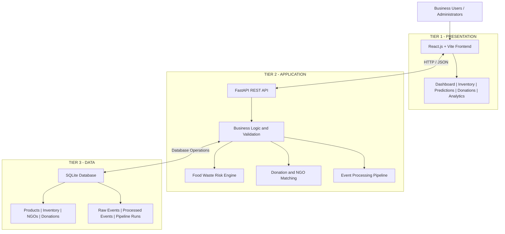
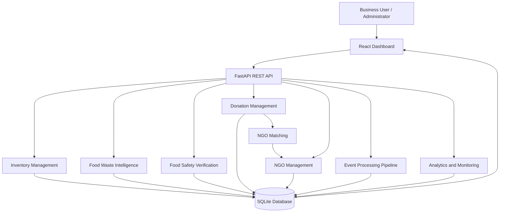
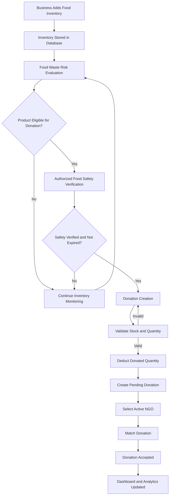
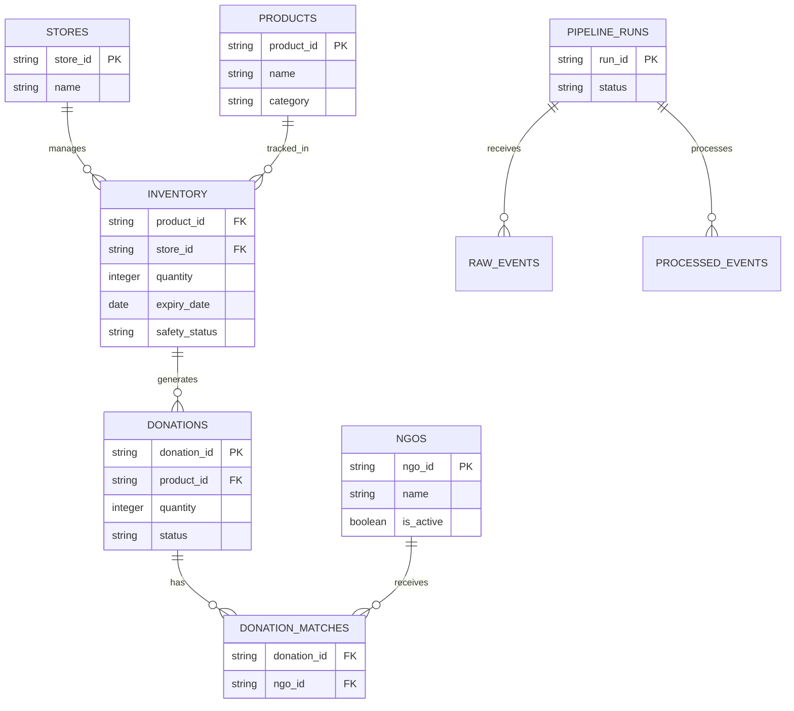

# 🍃 FoodRescue – Food Waste Intelligence & Redistribution Platform

**Turning Potential Food Waste into Community Resources**

FoodRescue is a food waste intelligence and redistribution platform designed to help supermarkets, grocery stores, bakeries, restaurants, and other food businesses identify potentially wasted food before it expires and coordinate its redistribution to NGOs and community organizations.

The platform monitors inventory, evaluates food expiry risk, identifies surplus products, supports food-safety verification, and enables businesses to create donations that can be matched with registered NGOs.

The primary objective is to reduce avoidable food waste while improving access to surplus food for communities in need.

---

## 📌 Table of Contents

1. [Problem Statement](#-problem-statement)
2. [Our Solution](#-our-solution)
3. [Key Features](#-key-features)
4. [Three-Tier Architecture](#-three-tier-architecture)
5. [System Architecture](#-system-architecture)
6. [System Workflow](#-system-workflow)
7. [Technology Stack](#-technology-stack)
8. [Backend Architecture](#-backend-architecture)
9. [Database Architecture](#-database-architecture)
10. [Food Waste Prediction Logic](#-food-waste-prediction-logic)
11. [Donation and NGO Matching](#-donation-and-ngo-matching)
12. [API Documentation](#-api-documentation)
13. [Project Structure](#-project-structure)
14. [Installation and Setup](#-installation-and-setup)
15. [Testing](#-testing)
16. [Security and Data Integrity](#-security-and-data-integrity)
17. [Current Implementation and Limitations](#-current-implementation-and-limitations)
18. [Future Enhancements](#-future-enhancements)
19. [Impact and Benefits](#-impact-and-benefits)
20. [Contributing](#-contributing)

---

## 🚨 Problem Statement

A significant amount of edible food is discarded by businesses because of:

- Poor inventory visibility.
- Products approaching their expiry dates.
- Overstocking and demand fluctuations.
- Lack of coordination between food businesses and NGOs.
- Delayed identification of surplus food.
- Limited infrastructure for organized food redistribution.

Traditional inventory management systems primarily focus on stock availability and sales. They often lack an integrated mechanism to identify potentially wasted food and connect it with organizations that can redistribute it.

**The challenge:** How can we identify food that is likely to become waste and redirect eligible surplus food to people who need it?

---

## 💡 Our Solution

FoodRescue introduces a proactive food waste intelligence and redistribution system.

Instead of waiting for food to expire or become unsellable, the platform continuously evaluates inventory information and identifies products that may require attention.

The platform supports the following process:

1. Businesses register and maintain their inventory.
2. The system monitors product quantities and expiry dates.
3. A rule-based prediction engine identifies potentially at-risk products.
4. Authorized personnel verify food safety.
5. Eligible surplus products can be converted into donations.
6. Donations can be matched with registered NGOs.
7. Donation status and inventory information are reflected in the dashboard.
8. Analytics and pipeline monitoring provide operational visibility.

**Our vision:** Identify surplus food early, coordinate redistribution efficiently, and reduce avoidable food waste.

---

## ✨ Key Features

### 1. Inventory Management

- Register food products.
- Maintain product quantities and expiry dates.
- Track product categories and safety status.
- Update inventory through sales and donation operations.
- Prevent invalid inventory operations.

### 2. Food Waste Intelligence

- Evaluate product expiry dates.
- Identify potentially at-risk inventory.
- Apply configurable rule-based risk evaluation.
- Display food risk information through the dashboard.

### 3. Food Safety Verification

- Maintain verification status for products.
- Support verification by authorized roles.
- Prevent expired products from being verified.
- Require verified products before donation creation.

### 4. Food Donation Management

- Create donations from eligible inventory.
- Validate available stock.
- Prevent invalid donation quantities.
- Deduct donated quantities from inventory.
- Track donation status.

### 5. NGO Management

- Maintain registered NGO information.
- Identify active NGO partners.
- Match pending donations with eligible NGOs.
- Track donation acceptance.

### 6. Analytics Dashboard

- Monitor inventory and donations.
- View food waste risk information.
- Display daily operational analytics.
- Track processing pipeline performance.

### 7. Data Pipeline Monitoring

- Record incoming events.
- Process sales and inventory events.
- Detect duplicate and invalid events.
- Track rejected and late events.
- Maintain pipeline execution history.

---

# 🏗️ Three-Tier Architecture

FoodRescue follows a three-tier software architecture. Each tier has a separate responsibility, making the application easier to maintain, test, and extend.

The three tiers are:

1. Presentation Tier
2. Application / Business Logic Tier
3. Data Tier

## Tier 1: Presentation Tier – Frontend

**Technology: React.js, Vite, JavaScript, CSS, Recharts**

The presentation tier provides the user interface through which business users and administrators interact with FoodRescue.

Responsibilities:

- Display inventory information.
- Register and manage food products.
- Show food waste risk predictions.
- Display donation information.
- Present NGO information.
- Display analytics and charts.
- Communicate with backend APIs.
- Refresh dashboard information.

The frontend communicates with the backend through HTTP requests using REST API endpoints.

It does not directly access the database.

## Tier 2: Application Tier – Backend

**Technology: Python, FastAPI, Pydantic**

The application tier contains the core business logic and acts as the central processing layer.

Responsibilities:

- Handle API requests from the frontend.
- Validate incoming data.
- Manage inventory operations.
- Evaluate food expiry and waste risk.
- Enforce food-safety verification requirements.
- Process sales and inventory events.
- Create and validate donations.
- Match donations with NGOs.
- Generate dashboard and analytics information.
- Maintain event-processing records.

FastAPI exposes REST APIs that allow the frontend to communicate with the application logic.

## Tier 3: Data Tier – Database

**Technology: SQLite**

The data tier provides persistent storage for the application's operational information.

It stores:

- Stores and business information.
- Product information.
- Inventory records.
- Raw and processed events.
- Rejected events.
- NGO information.
- Donation records.
- Donation matching history.
- Pipeline execution records.
- Daily analytics aggregates.

The backend accesses SQLite through the database module.

The frontend does not communicate directly with SQLite.

## Three-Tier Architecture Diagram



### Benefits of the Three-Tier Architecture

| Benefit | Description |
|---|---|
| Separation of concerns | Each tier has a dedicated responsibility. |
| Maintainability | Frontend, backend, and database can be developed independently. |
| Scalability | Individual tiers can be enhanced as requirements grow. |
| Reusability | Backend APIs can support additional clients in the future. |
| Data integrity | Database operations are managed by the backend. |
| Testability | Business logic and APIs can be tested independently. |

---

# 🔄 System Architecture

The system architecture describes how the major FoodRescue components interact to provide the complete food redistribution workflow.

## Main Components

### 1. User Interface Layer

Provides the dashboard and management screens for the application.

### 2. API Layer

Receives requests from the frontend and routes them to appropriate backend functions.

### 3. Inventory Management Module

Maintains product information, available quantities, expiry dates, and safety status.

### 4. Food Waste Intelligence Module

Evaluates inventory data and generates risk information using rule-based logic.

### 5. Food Safety Verification Module

Supports verification of eligible products by authorized personnel.

### 6. Donation Management Module

Creates donations, checks available inventory, and manages donation status.

### 7. NGO Matching Module

Assigns pending donations to active registered NGOs.

### 8. Event Processing Pipeline

Processes operational events, validates them, tracks duplicates, and records processing results.

### 9. Database Module

Stores application data and provides persistence across application restarts.

## System Architecture Diagram



---

# 🔁 System Workflow

FoodRescue follows an end-to-end process from inventory registration to donation matching.

### Step 1: Inventory Registration

Businesses add food products with details such as:

- Product name.
- Product category.
- Quantity.
- Expiry date.
- Unit.
- Safety status.

### Step 2: Inventory Monitoring

The backend maintains inventory information and evaluates product expiry and quantity conditions.

### Step 3: Food Waste Risk Identification

The prediction engine evaluates inventory and identifies products that may become surplus or approach expiry.

### Step 4: Food Safety Verification

Authorized personnel verify eligible products before they can be donated.

### Step 5: Donation Creation

A business selects an eligible product and specifies a donation quantity.

The backend validates:

- Product existence.
- Available inventory.
- Positive donation quantity.
- Expiry date.
- Food safety verification status.

After successful validation, the donation is recorded and inventory is reduced.

### Step 6: NGO Matching

The backend matches a pending donation with an active registered NGO.

### Step 7: Donation Acceptance

When matching succeeds, the donation status changes to `accepted`.

### Step 8: Monitoring and Analytics

The dashboard displays inventory, donations, prediction information, and operational analytics.

## End-to-End Workflow Diagram



---

# 🛠️ Technology Stack

| Layer | Technology | Purpose |
|---|---|---|
| Frontend | React.js | User interface |
| Frontend tooling | Vite | Development server and build tooling |
| Programming language | JavaScript | Frontend logic |
| Styling | CSS | Application styling |
| Visualization | Recharts | Dashboard charts |
| Backend | Python | Application programming |
| Backend framework | FastAPI | REST API development |
| Validation | Pydantic | Request data validation |
| Database | SQLite | Persistent data storage |
| Database access | Python SQLite3 | Database operations |
| Testing | Pytest | Automated testing |
| API testing | HTTPX / FastAPI TestClient | API integration testing |
| Version control | Git and GitHub | Source code management |

---

# ⚙️ Backend Architecture

The backend is developed using FastAPI and follows a modular structure.

## Backend Modules

### `main.py`

The main application entry point.

Responsibilities:

- Initialize the FastAPI application.
- Configure CORS.
- Initialize the database.
- Define REST API routes.
- Handle inventory operations.
- Manage donations and NGO matching.
- Provide dashboard and analytics endpoints.

### `database.py`

Responsible for database connectivity and initialization.

Responsibilities:

- Create SQLite database connections.
- Initialize database tables.
- Configure foreign key enforcement.
- Insert initial demonstration records.
- Manage database transactions.

### `schemas.py`

Defines Pydantic request models.

Responsibilities:

- Validate product registration data.
- Validate sales events.
- Validate donation requests.
- Enforce quantity constraints.

### `processor.py`

Implements the event-processing pipeline.

Responsibilities:

- Generate processing run identifiers.
- Validate incoming events.
- Record raw events.
- Detect duplicate events.
- Reject invalid events.
- Update inventory for sales events.
- Track late events.
- Record processing statistics.
- Update pipeline checkpoints.

---

# 🗄️ Database Architecture

FoodRescue uses SQLite for persistent storage.

The database is initialized automatically when the backend starts.

## Main Database Tables

| Table | Purpose |
|---|---|
| `stores` | Stores or business entities |
| `products` | Product master information |
| `inventory` | Product stock, expiry, and safety status |
| `raw_events` | Incoming operational events |
| `processed_events` | Successfully processed events |
| `rejected_events` | Invalid or rejected events |
| `ngos` | Registered NGO information |
| `donations` | Donation records and statuses |
| `donation_matches` | NGO matching history |
| `pipeline_runs` | Event-processing execution history |
| `pipeline_checkpoints` | Processing checkpoints |
| `daily_aggregates` | Daily operational analytics |

## Simplified Entity Relationship Diagram



*Note: This diagram is a simplified conceptual representation. Refer to `database.py` for the actual table definitions and constraints.*

---

# 🧠 Food Waste Prediction Logic

FoodRescue currently implements a **rule-based food waste risk evaluation mechanism**.

The system evaluates inventory attributes such as:

- Product expiry date.
- Remaining shelf life.
- Available stock quantity.
- Configured inventory thresholds.

The engine uses these attributes to identify potentially at-risk products.

### Why Rule-Based Prediction?

A rule-based approach is suitable for the current prototype because it:

- Does not require a historical training dataset.
- Is transparent and easy to understand.
- Produces explainable results.
- Can be tested using controlled inventory data.
- Can be extended with machine learning in the future.

### Future Machine Learning Possibilities

The system can later incorporate:

- Historical sales forecasting.
- Demand prediction.
- Seasonal consumption analysis.
- Expiry-based waste probability.
- Product-specific spoilage models.
- Dynamic surplus prediction.

**Important:** The current version does not use a trained machine-learning model. Its prediction results are based on programmed business rules.

---

# 🤝 Donation and NGO Matching

The donation module connects businesses with registered NGO partners.

## Donation Lifecycle

```text
Inventory
    |
    v
Food Safety Verification
    |
    v
Donation Creation
    |
    v
Pending
    |
    v
NGO Matching
    |
    v
Accepted
```

## Donation Validation

Before creating a donation, the backend checks:

1. Whether the product exists.
2. Whether the donation quantity is positive.
3. Whether sufficient stock is available.
4. Whether the product has expired.
5. Whether the product is verified as safe.

After successful validation, the donated quantity is deducted from inventory.

## NGO Matching Validation

The backend checks:

- Whether the donation exists.
- Whether the donation is still pending.
- Whether the selected NGO exists.
- Whether the NGO is active.
- Whether the donation can be assigned under the implemented matching rules.

Successful matching changes the donation status to `accepted` and records matching history.

### Demonstrated Workflow Test

The following transaction has been successfully tested against the local backend:

| Attribute | Result |
|---|---|
| Donation ID | `TEST_2CEA5251F2` |
| Product | Eggs |
| Quantity | 1 unit |
| NGO | Belagavi Community Kitchen |
| NGO ID | `NGO_001` |
| Final status | Accepted |

The test also confirmed that duplicate matching and deletion of an accepted donation are rejected by the backend.

---

# 🌐 API Documentation

The backend exposes REST APIs through FastAPI.

Base URL:

```text
http://127.0.0.1:8000
```

Interactive API documentation:

```text
http://127.0.0.1:8000/docs
```

## API Endpoints

| Method | Endpoint | Description |
|---|---|---|
| GET | `/health` | Check backend health |
| GET | `/api/dashboard/summary` | Retrieve dashboard summary |
| GET | `/api/inventory` | Retrieve inventory |
| POST | `/api/inventory` | Add inventory product |
| DELETE | `/api/inventory/{product_id}` | Delete eligible inventory record |
| POST | `/api/products/{product_id}/verify` | Verify product safety |
| POST | `/api/sales` | Record a sales event |
| GET | `/api/predictions` | Retrieve food waste predictions |
| GET | `/api/ngos` | Retrieve registered NGOs |
| GET | `/api/donations` | Retrieve donations |
| POST | `/api/donations` | Create a donation |
| DELETE | `/api/donations/{donation_id}` | Delete an eligible pending donation |
| POST | `/api/donations/{donation_id}/match` | Match donation with an NGO |
| GET | `/api/analytics/daily` | Retrieve daily analytics |
| GET | `/api/pipeline/runs` | Retrieve pipeline execution history |
| GET | `/api/pipeline/quality` | Retrieve pipeline quality information |
| POST | `/api/pipeline/process` | Process incoming events |

---

# 📁 Project Structure

The project is organized into separate frontend and backend directories.

```text
FoodRescue/
│
├── backend/
│   ├── app/
│   │   ├── __init__.py
│   │   ├── main.py
│   │   ├── database.py
│   │   ├── schemas.py
│   │   └── processor.py
│   │
│   ├── tests/
│   │   ├── __init__.py
│   │   ├── conftest.py
│   │   ├── test_api.py
│   │   └── test_foodrescue.py
│   │
│   ├── check_workflow.py
│   └── requirements.txt
│
├── frontend/
│   ├── public/
│   ├── src/
│   │   ├── App.jsx
│   │   ├── style.css
│   │   └── ...
│   │
│   ├── package.json
│   └── index.html
│
├── .gitignore
└── README.md
```

*The structure above is representative. Additional frontend and backend files may exist in the working repository.*

---

# 🚀 Installation and Setup

Follow these instructions to run FoodRescue locally.

## Prerequisites

Install the following:

- Python 3.10 or later.
- Node.js and npm.
- Git.
- A code editor such as Visual Studio Code.

## Step 1: Clone the Repository

```bash
git clone https://github.com/YOUR_USERNAME/FoodRescue.git
```

Navigate to the project:

```bash
cd FoodRescue
```

## Step 2: Backend Setup

Open a terminal:

```bash
cd backend
```

Create a Python virtual environment:

```bash
python -m venv .venv
```

Activate it on Windows PowerShell:

```powershell
..\.venv\Scripts\Activate.ps1
```

Install dependencies:

```bash
pip install -r requirements.txt
```

If a `requirements.txt` file is not available, install the main dependencies:

```bash
pip install fastapi uvicorn pydantic pytest httpx
```

Start the backend:

```bash
uvicorn app.main:app --reload
```

Backend URL:

```text
http://127.0.0.1:8000
```

Swagger documentation:

```text
http://127.0.0.1:8000/docs
```

## Step 3: Frontend Setup

Open another terminal:

```bash
cd frontend
```

Install frontend dependencies:

```bash
npm install
```

Start the frontend:

```bash
npm run dev
```

Frontend URL:

```text
http://localhost:5173
```

## Step 4: Access FoodRescue

Open the frontend in your browser:

```text
http://localhost:5173
```

Ensure that both frontend and backend servers are running.

---

# 🧪 Testing

FoodRescue includes automated backend tests and a separate donation workflow verification script.

## 1. Run Automated Tests

Navigate to the backend directory:

```bash
cd backend
```

Activate the virtual environment and run:

```bash
pytest -v
```

The test suite covers important application functionality, including:

- Backend health.
- Dashboard response.
- Inventory operations.
- Food safety verification.
- Sales processing.
- Donation creation.
- NGO matching.
- Predictions and analytics.
- Event pipeline processing.

**Previously verified result:** 38 tests passed.

## 2. Run Donation-to-NGO Workflow Test

Start the backend first.

In another terminal, navigate to `backend` and activate the environment.

Run:

```bash
python check_workflow.py
```

The script checks:

- Backend connectivity.
- Inventory API.
- Donations API.
- NGO API.
- Test donation creation when approved.
- NGO matching.
- Accepted donation status.
- Duplicate matching protection.
- Accepted donation deletion protection.

The end-to-end donation workflow has successfully passed these checks in the development environment.

---

# 🔐 Security and Data Integrity

The current prototype includes several validation and data integrity mechanisms.

### Input Validation

Pydantic models validate API request data, including quantity restrictions.

### Inventory Validation

The backend checks available stock before allowing donation operations.

### Food Safety Validation

Only verified, unexpired products are eligible for donation creation.

### Duplicate Matching Protection

Accepted donations cannot be matched again.

### Donation Deletion Protection

Accepted donations cannot be deleted through the donation deletion endpoint.

### Database Transactions

Database operations use transaction handling to commit successful operations and roll back operations when exceptions occur.

### Important Security Considerations

This is a hackathon prototype, not a production-hardened deployment. Production use would require authentication, authorization enforcement, secure credential management, stronger audit logging, deployment security, and additional data protection controls.

---

# ⚠️ Current Implementation and Limitations

The current implementation is a functional prototype demonstrating the core food waste identification and redistribution workflow.

The following distinctions are important:

- Food waste risk evaluation is currently rule-based rather than powered by a trained ML model.
- NGO matching is implemented through backend API operations; it is not an advanced optimization engine.
- NGO capacity information is not fully integrated into the current demonstrated workflow.
- Food safety verification is a workflow control, not a laboratory food safety assessment.
- Donation acceptance does not prove that physical collection or delivery has occurred.
- SQLite is used for local prototype storage.

These capabilities can be expanded as the platform evolves.

---

# 🔮 Future Enhancements

FoodRescue can be extended with the following capabilities:

### 1. Machine Learning-Based Prediction

Develop models using historical inventory, sales, demand, and expiry data to predict surplus food more accurately.

### 2. Intelligent NGO Matching

Introduce matching based on:

- NGO capacity.
- Geographic distance.
- Food category requirements.
- Collection availability.
- Donation urgency.

### 3. Real-Time Notifications

Notify NGOs and businesses when eligible donations become available.

### 4. Geolocation-Based Redistribution

Integrate maps and routing to optimize food collection and delivery.

### 5. Live Collection Tracking

Track donation pickup, transportation, and delivery status.

### 6. Advanced Analytics

Introduce:

- Estimated food waste avoided.
- Donation success rates.
- Food category analysis.
- Store-level performance.
- Redistribution trends.

### 7. Production Database

Migrate from SQLite to PostgreSQL for improved concurrent access and production scalability.

### 8. Authentication and Role-Based Access Control

Introduce secure login and permissions for:

- Business administrators.
- Food safety officers.
- NGO representatives.
- Platform administrators.

---

# 🌍 Impact and Benefits

FoodRescue aims to create value for multiple stakeholders.

| Stakeholder | Benefit |
|---|---|
| Supermarkets and retailers | Better inventory visibility and reduced avoidable waste |
| Restaurants and bakeries | Easier identification of surplus food |
| NGOs | Improved access to available food donations |
| Communities | Greater opportunities to receive redistributed food |
| Environment | Potential reduction in food waste and associated resource loss |

### Our Impact Goals

- Identify potentially wasted food before expiry.
- Encourage responsible inventory management.
- Improve coordination between businesses and NGOs.
- Support organized food redistribution.
- Contribute towards more sustainable food systems.

---

# 🤝 Contributing

Contributions and suggestions are welcome.

To contribute:

1. Fork the repository.
2. Create a feature branch.
3. Implement your changes.
4. Test your changes.
5. Submit a pull request.

---

# 👨‍💻 Project Information

**Project Name:** FoodRescue

**Category:** Food Waste Management / Sustainability / Social Impact

**Architecture:** Three-Tier Architecture

**Frontend:** React.js + Vite

**Backend:** Python + FastAPI

**Database:** SQLite

**Prediction Approach:** Rule-Based Food Waste Risk Evaluation

**Purpose:** Food waste intelligence and surplus food redistribution.

---

## 🌱 Final Note

FoodRescue is built around a simple but important idea:

**Food that is surplus for one organization can be a valuable resource for another.**

By combining inventory intelligence, expiry monitoring, food safety verification, and NGO coordination, FoodRescue aims to transform food waste management from a reactive process into a proactive redistribution system.

**Identify Early. Verify Safely. Redistribute Efficiently.**

🍃 *FoodRescue – Saving Food, Supporting Communities.*